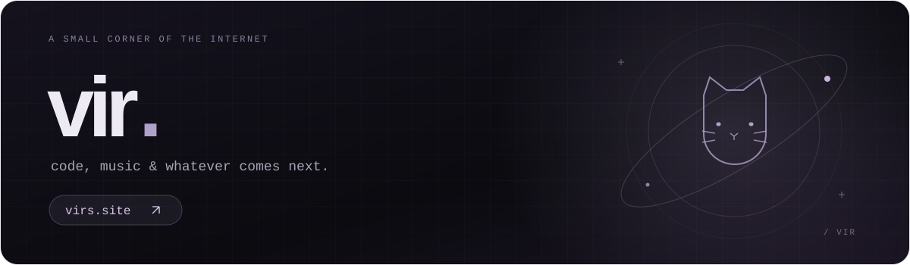

  

  <b>building things i want to use.</b> 
  C++ · Python · Lua · Luau · HTML

  <a href="https://virs.site"><b>virs.site ↗</b></a>
  &nbsp; / &nbsp;
  <a href="https://discord.com/users/205702996128956416">discord</a>
  &nbsp; / &nbsp;
  <a href="https://www.roblox.com/users/26376058/profile">roblox</a>

---

| project | what it is |
| :--- | :--- |
| **[virs.site ↗](https://virs.site)** | my personal corner of the internet — links, music, and a little cat. |
| **[virs hub ↗](https://github.com/larpingledger-star/virshub)** | a Roblox script hub i maintain. |

  find me at <a href="https://virs.site">virs.site</a> · made personal, by vir.

